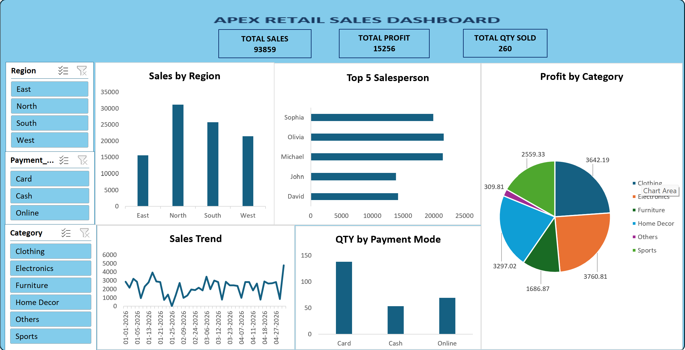

# 📊 Apex Retail Sales Dashboard | Excel

## 📌 Project Overview

The **Apex Retail Sales Dashboard** is an interactive Microsoft Excel dashboard designed to analyze retail sales performance, profitability, product categories, and customer purchasing behavior.

The goal of this project is to transform raw sales data into meaningful business insights through data analysis, visualization, and interactive reporting.

This dashboard helps users monitor key performance indicators (KPIs), identify sales trends, compare regional performance, and make data-driven business decisions.

## 🖥️ Dashboard Preview

## 🎯 Project Objectives

- 📈 Analyze overall sales performance and profitability.
- 🌎 Compare sales across different regions.
- 🏆 Identify the top-performing salespeople.
- 🛍️ Evaluate profitability across product categories.
- 💳 Analyze customer payment preferences.
- 📅 Monitor sales trends over time.
- 🔍 Enable interactive data exploration using Excel slicers.

## 📊 Key Performance Indicators (KPIs)

The dashboard highlights three important business metrics:

| KPI | Value |
|---|---:|
| 💰 Total Sales | $93,859 |
| 📈 Total Profit | $15,256 |
| 📦 Total Quantity Sold | 260 |

These KPIs provide a quick overview of the company's sales performance and profitability.

## 📉 Dashboard Visualizations

### 🌎 1. Sales by Region
A column chart compares total sales across four regions:

- East
- North
- South
- West

**Key Insight:** The North region generates the highest sales, while the East region records the lowest sales.

### 🏆 2. Top 5 Salespeople
A horizontal bar chart highlights the five leading salespeople:

- Olivia
- Michael
- Sophia
- David
- John

**Key Insight:** Olivia and Michael demonstrate strong sales performance, helping identify top contributors to business revenue.

### 🛍️ 3. Profit by Category
A pie chart illustrates profit distribution across six product categories:

- Clothing
- Electronics
- Furniture
- Home Decor
- Others
- Sports

**Key Insight:** Electronics and Clothing contribute significantly to overall profitability, while the Others category has the smallest profit contribution.

### 📅 4. Sales Trend
A line chart displays sales fluctuations over time.

**Key Insight:** Sales vary throughout the reporting period, with noticeable peaks and declines. This visualization helps identify performance patterns and potential opportunities for improvement.

### 💳 5. Quantity Sold by Payment Mode
A column chart compares quantities sold using three payment methods:

- 💳 Card
- 💵 Cash
- 🌐 Online

**Key Insight:** Card payments account for the highest quantity sold, followed by Online and Cash payments.

## 🎛️ Interactive Dashboard Features

The dashboard includes three interactive Excel slicers:

**🌎 Region Slicer**
- East, North, South, West

**💳 Payment Mode Slicer**
- Card, Cash, Online

**🛍️ Product Category Slicer**
- Clothing, Electronics, Furniture, Home Decor, Others, Sports

These slicers allow users to filter information and explore sales performance across different business segments.

## 🛠️ Tools & Technologies

| Tool | Purpose |
|---|---|
| Microsoft Excel | Data analysis and dashboard development |
| Pivot Tables | Data aggregation and summarization |
| Pivot Charts | Visual representation of sales data |
| Excel Slicers | Interactive data filtering |
| Excel Formulas | KPI calculations and analysis |
| Data Visualization | Communicating business insights |

## 🧠 Skills Demonstrated

Through this project, I practiced and demonstrated:

- ✅ Data cleaning and preparation
- ✅ Data analysis and reporting
- ✅ KPI development and monitoring
- ✅ Excel Pivot Tables and Pivot Charts
- ✅ Interactive dashboard design
- ✅ Business performance analysis
- ✅ Data visualization and storytelling
- ✅ Analytical thinking and problem-solving

## 💡 Business Insights

The dashboard provides several valuable insights:

1. **Regional Performance:** The North region leads in sales, highlighting strong regional performance.
2. **Salesperson Productivity:** Top-performing employees can be identified for performance recognition and sales strategy development.
3. **Product Profitability:** Electronics and Clothing are major profit contributors.
4. **Customer Payment Behavior:** Card payments represent the largest share of quantities sold.
5. **Sales Monitoring:** Tracking sales trends helps businesses evaluate performance over time.

## 🚀 How to Use the Dashboard

1. Download the Excel dashboard file from this repository.
2. Open the workbook using Microsoft Excel.
3. Navigate to the dashboard worksheet.
4. Use the Region, Payment Mode, and Category slicers to filter the data.
5. Explore the charts and KPIs to analyze business performance.

## 📚 What I Learned

This project helped me strengthen my Microsoft Excel and data analytics skills by creating an interactive business dashboard.

I gained practical experience organizing sales data, building Pivot Tables, creating visualizations, and presenting key business metrics in a clear and understandable format.

I also learned how interactive dashboards can help businesses monitor performance, identify trends, and support data-driven decision-making.

## 🔮 Future Improvements

- 📊 Add monthly and quarterly sales comparisons.
- 📈 Include profit margin and growth rate KPIs.
- 🎯 Introduce sales targets and performance tracking.
- 🔄 Automate data updates using Power Query.
- 📉 Expand the dashboard with additional customer and product analysis.

## ⭐ Conclusion

The **Apex Retail Sales Dashboard** demonstrates how Microsoft Excel can be used to transform sales data into an interactive and informative business intelligence tool.

This project highlights my growing skills in **Excel, data analytics, dashboard development, and business reporting**.

---

⭐ Thank you for exploring my project!

**#Excel #DataAnalytics #ExcelDashboard #DataVisualization #BusinessIntelligence #SalesAnalysis #PortfolioProject**
